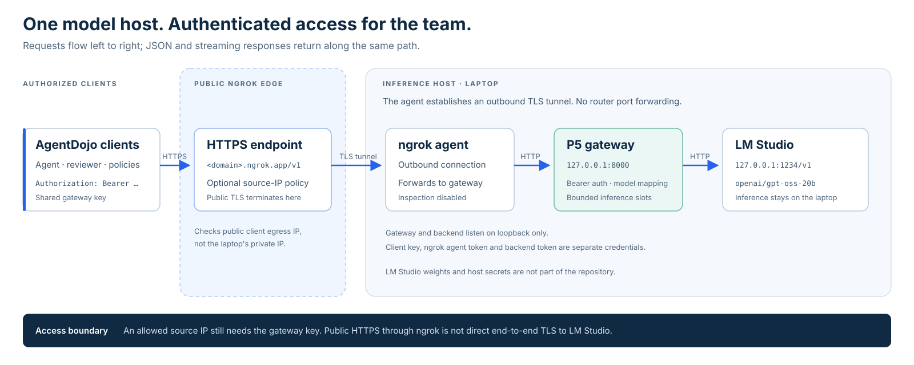

# P5 Inference Gateway

Host the project's language model on one laptop and share an authenticated,
OpenAI-compatible API with teammates through an HTTPS ngrok endpoint.

This package adapts the standalone `LLM_server` implementation into the
`agentdojo-safety-policies` repository. It provides bearer authentication,
JSON and streaming chat completions, model-name mapping, bounded inference
concurrency, readiness checks, and optional managed tunneling. Dependencies and
host configuration are separate from the benchmark runner.

## Architecture



Requests travel left to right; JSON responses and server-sent events return
along the same path. The ngrok agent establishes the outbound tunnel from the
laptop. Neither LM Studio's port nor the gateway port needs router forwarding.
The public hostname belongs to ngrok; inference runs on the host laptop.

| Component | Address or identifier | Responsibility |
|---|---|---|
| Public endpoint | `https://<your-ngrok-domain>/v1` | Team-facing API base URL |
| Gateway | `http://127.0.0.1:8000` | Validate bearer key, queue requests, map model name |
| LM Studio | `http://127.0.0.1:1234/v1` | Execute the loaded model |
| Published model | `openai/gpt-oss-20b` | Stable model ID requested by clients |

## Start the inference host

Run commands from the repository root. Prerequisites are Python 3.11 or newer,
[LM Studio with its `lms` CLI](https://lmstudio.ai/docs/cli), and an ngrok account
for remote access.

### 1. Prepare an isolated environment

```bash
python3 -m venv p5_inferencing/.venv
source p5_inferencing/.venv/bin/activate
python -m pip install -r p5_inferencing/requirements-lock.txt
cp p5_inferencing/.env.example p5_inferencing/.env
chmod 600 p5_inferencing/.env
python -c 'import secrets; print(secrets.token_urlsafe(32))'
```

Use the generated value for `API_KEY` in your **local** `p5_inferencing/.env`.
Keep an existing configuration rather than copying over it. Only the example
file belongs in Git; a real `.env` is never included in this package.

The lock file pins the gateway environment independently from the benchmark.
`requirements.txt` declares compatible ranges for deliberate dependency updates.

The minimum host configuration is:

```dotenv
API_KEY=<paste-a-unique-random-secret-of-at-least-32-characters>
LM_STUDIO_BASE_URL=http://127.0.0.1:1234/v1
LM_STUDIO_MODEL=openai/gpt-oss-20b
PUBLIC_MODEL=openai/gpt-oss-20b
ENABLE_NGROK=false
```

`python -m p5_inferencing` reads only `p5_inferencing/.env`, not the
benchmark runner's root `.env`. Explicit process environment settings take
precedence. Select another file with `--env-file /path/to/host.env`.

### 2. Load the available model

Inspect the machine's downloaded and loaded models:

```bash
lms ls
lms ps
```

The source host has the following downloaded GGUF files. Downloaded does not
mean loaded or ready for inference:

| Model | Local file | Intended use |
|---|---|---|
| GPT-OSS 20B | `lmstudio-community/gpt-oss-20b-GGUF/gpt-oss-20b-MXFP4.gguf` | Shared project model |
| Qwen 3.5 4B | `lmstudio-community/Qwen3.5-4B-GGUF/Qwen3.5-4B-Q4_K_M.gguf` | Optional local development; a different experimental setup |

Load GPT-OSS 20B and assign the API identifier used by the project:

```bash
lms load gpt-oss-20b \
  --identifier openai/gpt-oss-20b \
  --context-length 32768
lms ps
lms server start --bind 127.0.0.1 --port 1234
lms server status
curl --fail-with-body http://127.0.0.1:1234/v1/models
```

Use the matching model key printed by `lms ls` if the short name is ambiguous.
The context length is an explicit starting configuration: confirm that it fits
the host's memory and keep it consistent across comparisons. For shared project
runs, keep model file/quantization, reasoning settings and context length fixed.
Disable KV-cache quantization if the runtime reports
`RotatingKVCache Quantization NYI`.

If LM Studio authentication is enabled, set `LM_STUDIO_API_KEY` in the host
`.env` and authenticate the direct backend curl check with that separate token.
The client-facing `API_KEY` is not forwarded to LM Studio. See the
[model loading](https://lmstudio.ai/docs/cli/local-models/load) and
[server binding](https://lmstudio.ai/docs/cli/serve/server-start) references.

### 3. Start the gateway

```bash
python -m p5_inferencing
```

Leave this terminal running. In another terminal, load the host environment and
check the gateway:

```bash
set -a
source p5_inferencing/.env
set +a

curl --fail-with-body http://127.0.0.1:8000/health
curl --fail-with-body http://127.0.0.1:8000/ready \
  -H "Authorization: Bearer $API_KEY"
curl --fail-with-body http://127.0.0.1:8000/v1/models \
  -H "Authorization: Bearer $API_KEY"
```

`/health` checks the gateway process only. `/ready` checks backend reachability
and whether LM Studio lists the configured model. It does not generate tokens
or prove that the weights are already resident in memory; `lms ps` checks
loaded models. `/v1/models` advertises the configured public model.

## Publish an ngrok tunnel

### Separate terminal

Keep `ENABLE_NGROK=false`. In a second terminal, load the host `.env` as above,
set its `NGROK_AUTHTOKEN` to your ngrok agent token, and run:

```bash
ngrok http http://127.0.0.1:8000 --inspect=false
```

Use the HTTPS forwarding URL printed by ngrok and append `/v1` for clients.
If `GATEWAY_PORT` was changed, use the same port here. Tunnel the **gateway**
on port 8000, so its bearer check remains in the request path. Forwarding
directly to LM Studio on port 1234 would skip the gateway.

### Managed tunnel

Alternatively, put these values in the host's local `.env`:

```dotenv
ENABLE_NGROK=true
NGROK_AUTHTOKEN=<your-ngrok-agent-token>
```

Then run `python -m p5_inferencing`. The gateway opens an HTTPS tunnel, prints
the public API base URL, disables local request inspection and disconnects its
tunnel on normal shutdown. Choose one tunnel method. The managed mode does not
configure an IP allowlist; use the explicit policy below when one is required.

An ngrok agent token authenticates the **host to ngrok**. `API_KEY`
authenticates **clients to the gateway**. Share the latter privately with
authorized teammates; keep the ngrok token and any backend token on the host.

## IP matching and security

`127.0.0.1` means the current machine. A teammate cannot reach your laptop by
using `127.0.0.1` or its private `192.168.x.x` address through the internet.
They use the ngrok hostname. Its DNS address points to an ngrok edge, not
directly to your laptop.

For an allowlist, match each client's **public egress IP as seen by ngrok**,
including a VPN or corporate proxy's egress address. A single IPv4 address uses
`/32`; a single IPv6 address uses `/128`. Shared NAT addresses identify a network,
not an individual, and IPs can change.

Copy the example, replace its documentation-only address with your actual
permitted client IPs, and start a separate tunnel:

```bash
cp p5_inferencing/ngrok-policy.example.json p5_inferencing/ngrok-policy.json
# Edit the "allow" list in the local ngrok-policy.json.
ngrok http http://127.0.0.1:8000 --inspect=false \
  --traffic-policy-file p5_inferencing/ngrok-policy.json
```

The example sets `enforce: true`. ngrok checks connection-source IPs, rather
than trusting `X-Forwarded-For`, and rejects nonmatching HTTP requests with
403 before the gateway. Confirm that the feature is available for your
account. IP access and bearer authentication are separate layers: an allowed
client still needs the key. The gateway does not implement its own IP allowlist.
[ngrok IP restriction reference](https://ngrok.com/docs/gateway/traffic-policy/actions/restrict-ips)

Both local services bind to loopback; leave LM Studio LAN access and CORS off
unless deliberately needed. Public HTTPS terminates at ngrok, so ngrok is part
of the trust boundary; this setup is not end-to-end TLS directly into the model
process. Avoid sensitive production data in this team development service.
Inspection is disabled locally to reduce request/body capture, but that is not
a promise of zero provider-side logging. Rotate shared keys after exposure or
when team access changes. Bounded concurrency and body limits protect resources;
they are not per-user quotas or rate limiting.

## Connect AgentDojo clients

On each teammate's machine, edit the repository-root `.env`, using the public
gateway URL and the **gateway** key:

```dotenv
LLM_PROVIDER=lmstudio
LMSTUDIO_MODEL=openai/gpt-oss-20b
LMSTUDIO_BASE_URL=https://<your-ngrok-domain>/v1
LMSTUDIO_API_KEY=<shared-gateway-api-key>
```

Keep `REVIEWER_*` and `PROVENANCE_*` overrides unset for the shared configuration:
the reviewer and provenance model follow the agent. A generic compatible client
must set its actual API base URL; changing a Groq key does not redirect a
hard-coded Groq endpoint to this gateway.

Check model access from the client:

```bash
set -a
source .env
set +a
curl --fail-with-body "$LMSTUDIO_BASE_URL/models" \
  -H "Authorization: Bearer $LMSTUDIO_API_KEY" \
  -H "ngrok-skip-browser-warning: 1"
```

For a minimal local chat check on the inference host:

```bash
curl --fail-with-body http://127.0.0.1:8000/v1/chat/completions \
  -H "Authorization: Bearer $API_KEY" \
  -H "Content-Type: application/json" \
  -d '{
    "model": "openai/gpt-oss-20b",
    "messages": [{"role": "user", "content": "Reply with one short greeting."}],
    "max_tokens": 256,
    "stream": false
  }'
```

For streaming, use `curl -N` and `"stream": true`. The gateway forwards
messages, tools, generation options and structured-output settings to LM Studio;
model/runtime support determines which options work. Its completion response
retains LM Studio's upstream model identifier. A public alias changes the
listing and accepted request name, not every identifier inside generated output.

## Configuration and API

| Setting | Default | Purpose |
|---|---|---|
| `API_KEY` | Required | At least 32 characters; generated separately from provider tokens |
| `LM_STUDIO_BASE_URL` | `http://127.0.0.1:1234/v1` | Backend API; HTTP(S), no embedded credentials or query |
| `LM_STUDIO_MODEL` | `openai/gpt-oss-20b` | Exact backend model ID |
| `LM_STUDIO_API_KEY` | Empty | Optional LM Studio authentication token |
| `PUBLIC_MODEL` | `openai/gpt-oss-20b` | Model name exposed by the gateway |
| `GATEWAY_PORT` | `8000` | Loopback listening port |
| `MAX_CONCURRENT_REQUESTS` | `2` | Active upstream chat requests, including open streams |
| `QUEUE_TIMEOUT_SECONDS` | `30` | Maximum wait for an inference slot |
| `REQUEST_TIMEOUT_SECONDS` | `600` | Upstream HTTP operation timeout; not a whole-stream deadline |
| `MAX_REQUEST_BYTES` | `2097152` | Request-body limit, including chunked bodies |
| `ENABLE_NGROK` | `false` | Opt-in managed tunnel |
| `NGROK_AUTHTOKEN` | Empty | Required only for managed tunneling or ngrok CLI authentication |
| `LOG_LEVEL` | `info` | `critical`, `error`, `warning`, `info` or `debug` |

| Route | Authentication | Meaning |
|---|---|---|
| `GET /health` | None | Process liveness |
| `GET /ready` | Bearer | Backend reachable and configured model listed |
| `GET /v1/models` | Bearer | Single configured public model |
| `POST /v1/chat/completions` | Bearer | JSON or SSE completion proxy |

The gateway returns 401 for missing/invalid credentials, 400 for invalid JSON,
unsupported model IDs or malformed basic chat fields, 413 for oversized bodies,
503 for a busy queue or unavailable readiness check, and 502 for upstream
connection/read failures. LM Studio HTTP error statuses are passed through.
An already-started SSE stream cannot change its HTTP status after a later
upstream failure; clients must handle interrupted streams.

## Test and operate

Offline tests use a mock LM Studio transport and mocked ngrok calls:

```bash
python -m unittest discover -s p5_inferencing/tests -v
```

Stop the gateway and a separately launched ngrok process with `Ctrl+C`. A managed
tunnel is disconnected by the gateway on normal exit. When finished hosting:

```bash
lms server stop
lms unload openai/gpt-oss-20b
```

| Symptom | Check |
|---|---|
| Startup rejects `API_KEY` | Generate a new 32+ character secret and set the host's package-local `.env`. |
| `/health` works, `/ready` returns 503 | Start LM Studio; check `lms ps`, backend auth and exact model ID. |
| 401 from gateway | Use `Authorization: Bearer ...` with the gateway key, not the ngrok token. |
| 403 from ngrok | Check the client's current public egress IP, IPv4/IPv6 and enforced allowlist. |
| ngrok upstream/502 error | Keep the gateway running; verify port 8000 matches the tunnel target. |
| Busy 503 or an interrupted stream | Reduce simultaneous runs; inspect backend capacity and timeout settings. |
| Empty agent output or context errors | Verify loaded model, context/memory and runtime settings; avoid changing them mid-comparison. |
| Model-list request returns an ngrok browser page | Use a proper API client or the `ngrok-skip-browser-warning` header. |

### Optional direct Groq diagnostic

The imported Groq smoke test is a separate development diagnostic and makes
external, potentially billable requests; it does not exercise LM Studio or ngrok.
Set `GROQ_API_KEY` locally, then:

```bash
python -m pip install -r p5_inferencing/requirements-groq.txt
python -m p5_inferencing.groq_smoke_test
```

Groq results are not the project's shared LM Studio benchmark configuration.

## Package layout

```text
p5_inferencing/
  README.md                    host and client runbook
  .env.example                 placeholders only
  .gitignore                   local secrets and runtime files
  __main__.py                  loopback server entry point
  config.py                    validated, explicit configuration
  app.py                       HTTP gateway and optional tunnel lifecycle
  groq_smoke_test.py            optional external-provider diagnostic
  requirements.txt             gateway dependency ranges
  requirements-lock.txt        pinned gateway dependencies
  requirements-groq.txt        optional diagnostic dependencies
  ngrok-policy.example.json    example IP allowlist; no real client addresses
  docs/architecture.svg        editable vector architecture diagram
  tests/                       offline configuration and HTTP tests
```

The gateway accepts requests from trusted key holders and exposes only the listed
routes. It is a single-model team inference service, with no user management,
per-user billing, distributed queues or production availability guarantee.
The source directory's `.env`, virtual environment, caches and model binaries
are intentionally excluded.

References: [LM Studio CLI](https://lmstudio.ai/docs/cli),
[ngrok CLI and tunnel options](https://ngrok.com/docs/gateway/agent/cli),
[ngrok IP restrictions](https://ngrok.com/docs/gateway/traffic-policy/actions/restrict-ips),
[ngrok traffic inspection](https://ngrok.com/docs/gateway/agent/web-inspection-interface).
